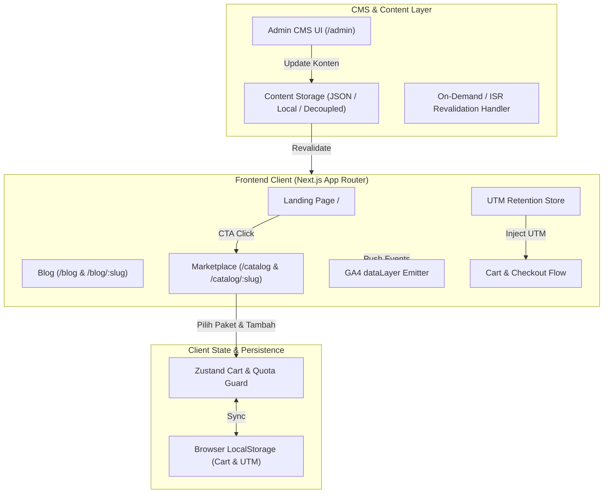

# Project Overview — `cms_simple` (Technical Skill Test PT Digital Solusi Grup)

> **Status**: Greenfield Blueprint / Master Architecture & Traceability Document  
> **Brand**: Kodeva (Software Bisnis UMKM: POS Kasir, HR & Payroll, Add-on)  
> **Target Evaluasi**: Fullstack Developer (Frontend-Heavy)  
> **Ref Dokumen**: `TECHNICAL_SKILL_TEST.md` & `constitution.md`

---

## 1. Konteks Bisnis & Sasaran Proyek

Brand fiktif **Kodeva** menjual solusi SaaS/software lisensi berlangganan untuk pelaku usaha UMKM. Menjelang akhir tahun, tim marketing meluncurkan campaign **"Promo Akhir Tahun"** dengan sasaran:
- **Konversi Cepat**: Landing page mobile-first yang responsif, cepat (Lighthouse ≥ 80), ramah kampanye ads Instagram & TikTok (80% traffic).
- **Kemandirian Marketing**: CMS yang mudah digunakan user non-teknis untuk mengubah banner hero, teks promo, testimoni, FAQ, dan menerbitkan artikel blog SEO tanpa perlu campur tangan developer.
- **Katalog & Checkout Terpercaya**: Pengalaman belanja mini marketplace yang mulus, mendukung paket produk bertingkat (*Basic / Pro / Business*), pencegahan eksploitasi kuota promo lintas-paket, serta simulasi pembayaran sukses & gagal.
- **Data & Attribution**: Pelacakan event GA4 dataLayer anti duplikasi dan retensi parameter UTM iklan hingga transaksi terjadi.

---

## 2. Rencana Arsitektur & Tech Stack

### Arsitektur Sistem

### Rekomendasi Tech Stack
- **Framework**: **Next.js 14/15 (App Router, TypeScript strict, React 18/19)**  
  *Alasan*: Mendukung Server-Side Rendering (SSR) dan Static Site Generation (SSG/ISR) untuk Core Web Vitals optimal, dynamic SEO meta tags/OpenGraph, built-in API routing, dan zero-config revalidation.
- **Styling**: **Tailwind CSS + PostCSS**  
  *Alasan*: Utility-first, footprint CSS minimal (purged), mobile-first responsive design, mempermudah pencapaian Lighthouse Mobile ≥ 80.
- **State Management**: **Zustand** (dengan middleware `persist`)  
  *Alasan*: Sangat ringan (< 2KB), tidak membebani initial bundle, modular, mudah diuji untuk logika kuota bersama (*shared quota guard*).
- **CMS Model**: **Embedded Lightweight Admin CMS** (Route `/admin`)  
  *Alasan*: Memungkinkan live demo langsung dijalankan oleh reviewer tanpa ketergantungan external microservice yang kompleks, mudah di-deploy ke Vercel/Netlify satu kesatuan dengan login admin demo.
- **Testing**: **Vitest / React Testing Library**  
  *Alasan*: Menjalankan automated test untuk shared quota rule dan perhitungan diskon.

---

## 3. Spesifikasi Fungsional & Kebutuhan Modul

### Modul A: Website Landing & Blog (CMS)
1. **Landing Page Sections**:
   - Hero Section: Title, Subtitle, CTA Button, Hero Image/Illustration.
   - Featured Products: Grid 3 produk unggulan dengan harga promo dan badge diskon.
   - Testimonial: Carousel / grid review pelanggan UMKM.
   - FAQ: Accordion interaktif pertanyaan umum.
   - Lead Capture Form: Input Nama, Email / WhatsApp, proteksi honeypot spam dasar, penyimpanan lead list.
2. **Blog System**:
   - List Artikel: Pagination, filter kategori, cover thumbnail, excerpt.
   - Detail Artikel: Dynamic routing `[slug]`, typography rich text, badge kategori, OpenGraph meta tags WhatsApp-friendly.
   - **Product Attachment**: Artikel dapat menautkan produk marketplace terkait (CTA pembelian langsung).
3. **CMS Management & Caching**:
   - Interface admin ramah pengguna untuk CRUD landing section, artikel, dan daftar leads.
   - Strategi Revalidation: ISR dengan on-demand revalidation hook saat admin menyimpan konten.

### Modul B: Mini Marketplace (Frontend)
1. **Katalog Produk**:
   - Minimal 6 produk dummy (POS Kasir Retail, POS Resto & Kafe, Payroll & HRIS, Absensi GPS Add-on, Inventory Multi-Outlet, Accounting Connector).
   - Filter kategori interaktif.
2. **Detail Produk & Pilihan Paket**:
   - Galeri / tangkapan layar fitur.
   - Pilihan paket bertingkat: *Basic*, *Pro*, *Business* dengan diferensiasi harga instan.
   - Label harga normal, harga promo tercoret, dan indikator sisa kuota promo.
3. **Keranjang Belanja (Cart)**:
   - Tambah lisensi, ubah kuantitas (outlet/user), hapus lisensi.
   - Persistence ke `localStorage` (tahan refresh).
4. **Logika Kuota Bersama (Shared Promo Quota Guard)**:
   - *Requirement*: Jika produk A memiliki sisa kuota promo 10 lisensi, dan user menambahkan Paket Basic (4 lisensi) + Paket Pro (5 lisensi) dari produk A, maka total kuota terpakai adalah 9/10. User tidak boleh menambah lebih dari 1 lisensi lagi untuk produk A, terlepas dari paket mana pun yang dipilih.
5. **Checkout & Simulasi Pembayaran**:
   - Form pembeli (Nama, Email, Telepon) dengan validasi regex/required.
   - Ringkasan rincian biaya.
   - Simulator payment gateway: Tombol simulasi "Bayar Sukses" (menuju halaman order confirmation + nomor invoice dummy) dan "Simulasi Gagal" (menampilkan pesan penolakan pembayaran & opsi coba lagi).
6. **Robust State Handling**: Skeleton loading, empty states (keranjang kosong, produk tidak ada), toast error notification.

### Modul C: Kebutuhan Marketing & Analytics
1. **Mobile Performance**:
   - Mobile viewport, responsive layout, fluid touch targets (min 48px).
   - Optimasi aset gambar (Next/Image WebP, proper aspect ratio, minimal layout shift / CLS = 0).
   - Audit target: Lighthouse Mobile Performance ≥ 80.
2. **GA4 dataLayer Integration**:
   - Mengirim event standar e-commerce ke `window.dataLayer`:
     - `view_item`: Triggered saat user melihat detail produk.
     - `add_to_cart`: Triggered saat tombol tambah ke keranjang diklik.
     - `begin_checkout`: Triggered saat user membuka form checkout.
     - `landing_cta_click`: Triggered saat klik tombol CTA utama landing page.
   - **Deduplikasi**: Event diproteksi agar tidak re-trigger saat komponen me-render ulang.
   - Menyertakan payload item e-commerce lengkap (`item_id`, `item_name`, `price`, `item_category`, `quantity`, `campaign_name`).
3. **Parameter UTM Preservation**:
   - Deteksi query parameters saat user mendarat: `utm_source`, `utm_medium`, `utm_campaign`, `utm_content`.
   - Simpan ke session storage / local storage.
   - Otomatis disematkan pada:
     1. Form submission lead capture.
     2. Mock order checkout payload.

---

## 4. Asumsi & Resolusi Hal Ambigu (Sesuai Arahan Brief)

Brief menyebutkan: *"Pesan ini sengaja tidak menjawab semua pertanyaan... tulis asumsi Anda di README."* Berikut asumsi teknis yang telah dipetakan:

1. **Ekspansi Malaysia & Singapura**:
   - *Asumsi*: Website saat ini menggunakan bahasa Indonesia dan mata uang IDR sebagai default, namun arsitektur disiapkan modular untuk lokalisasi (i18n ready dictionary dan formatter currency dinamis).
2. **Penyimpanan Leads & Mock Order**:
   - *Asumsi*: Karena backend belum dibangun, data lead capture dan order simulasi disimpan pada runtime browser storage / file mock yang dapat dilihat langsung oleh tim marketing di CMS dashboard `/admin`.
3. **Mekanisme Kuota Promo**:
   - *Asumsi*: Kuota promo adalah kuota global per produk pada campaign saat ini. Sisa kuota dihitung dari `initial_promo_quota - total_in_cart` (dan divalidasi ulang saat checkout).
4. **Proteksi Spam Lead Form**:
   - *Asumsi*: Digunakan proteksi honeypot field (hidden input yang bila diisi bot maka form ditolak) dan client-side debounce rate limiting.

---

## 5. Rencana Arsitektur Backend di `README.md` (Mandatory Deliverable)

Berikut blueprint yang wajib didokumentasikan di `README.md` untuk menjawab requirement poin 5:
- **API Endpoints**:
  - `POST /api/v1/orders` (Create pending order + lock quota)
  - `POST /api/v1/payments/create-session` (Payment Gateway redirect/token)
  - `POST /api/v1/webhooks/payment` (Idempotent payment webhook)
  - `GET /api/v1/orders/:id/status` (Order status polling / SSE)
- **Alur Payment Gateway Aman**:
  - Validasi HMAC signature dari header webhook (`X-Signature`).
  - Idempotency key per invoice transaksi untuk mencegah double fulfillment.
  - State machine order: `PENDING` → `PAID` / `EXPIRED` / `FAILED`.
- **Manajemen Kuota Lisensi Promo Akurat (Anti Race Condition)**:
  - Redis distributed locking / Database row locking (`SELECT ... FOR UPDATE` atau decrement atomic `UPDATE products SET promo_quota = promo_quota - ? WHERE id = ? AND promo_quota >= ?`).
  - Kuota berstatus *reserved* dengan TTL 15 menit selama proses checkout, otomatis di-*release* jika pembayaran gagal/expired.
- **Pengiriman Lisensi**:
  - Background worker (BullMQ / RabbitMQ) mengirim serial key lisensi dan receipt PDF via email (SendGrid/Resend) dan WhatsApp API segera setelah webhook berstatus `PAID`.

---

## 6. Requirement Traceability Matrix (RTM)

| ID | Klausul Requirement Brief | Komponen Implementasi | Status |
| :--- | :--- | :--- | :--- |
| **REQ-A1** | Landing section: Hero, Featured, Testimonial, FAQ | `components/landing/` | Planned |
| **REQ-A2** | Konten section diedit lewat CMS oleh user non-teknis | `app/admin/` & `lib/cms/` | Planned |
| **REQ-A3** | Form lead capture + validasi + proteksi spam | `components/landing/LeadForm.tsx` | Planned |
| **REQ-A4** | Blog list (pagination) & Blog detail (`[slug]`) | `app/blog/page.tsx` & `app/blog/[slug]/page.tsx` | Planned |
| **REQ-A5** | Blog CMS: judul, slug, cover, rich text, kategori, draft/publish, tautan produk | `app/admin/articles/` | Planned |
| **REQ-A6** | Perubahan CMS tampil tanpa manual deploy + strategi caching | On-demand revalidation / ISR | Planned |
| **REQ-B1** | Katalog minimal 6 produk dengan filter kategori | `app/catalog/page.tsx` | Planned |
| **REQ-B2** | Detail produk: screenshot, harga coret, sisa kuota, paket Basic/Pro/Biz | `app/catalog/[slug]/page.tsx` | Planned |
| **REQ-B3** | Cart: tambah, ubah qty, hapus, subtotal otomatis, persist refresh | `store/useCartStore.ts` | Planned |
| **REQ-B4** | Kuota promo bersama lintas paket dalam produk yang sama | `lib/quotaGuard.ts` | Planned |
| **REQ-B5** | Checkout form validasi + simulasi bayar sukses/gagal | `components/checkout/` | Planned |
| **REQ-B6** | Loading, error, dan empty states di seluruh UI | `components/ui/` (Skeleton, EmptyState, Toast) | Planned |
| **REQ-B7** | Mobile-first UX & keranjang mudah diakses dari semua halaman | `components/layout/Navbar.tsx` & Cart Drawer | Planned |
| **REQ-C1** | Lighthouse Mobile Performance ≥ 80 | WebP images, zero layout shift, font optimization | Planned |
| **REQ-C2** | GA4 dataLayer: view_item, add_to_cart, begin_checkout, cta_click | `hooks/useAnalytics.ts` | Planned |
| **REQ-C3** | Preservasi parameter UTM ke form lead dan checkout payload | `hooks/useUTM.ts` | Planned |
| **REQ-D1** | `README.md` (setup, arsitektur, asumsi, rencana backend, Lighthouse) | `README.md` | Planned |
| **REQ-D2** | `AI_LOG.md` (tools, prompt, 2 koreksi AI, edge case test, kode manual) | `AI_LOG.md` | Planned |

---

## 7. Matriks Edge Cases & Mitigasi Risiko

| Area | Potensi Risiko / Edge Case | Strategi Mitigasi |
| :--- | :--- | :--- |
| **Quota Guard** | User menambah kuantitas dari katalog, detail produk, dan keranjang secara bergantian hingga melebihi batas kuota produk. | Kalkulasi total kuantitas produk teragregasi di custom hook/Zustand selector `getProductTotalQuantityInCart(productId)`. Nonaktifkan tombol tambah jika `total >= maxQuota`. |
| **Tracking** | `useEffect` me-mount dua kali di React Strict Mode (Development), mengirim double `view_item`. | Gunakan tracking hook dengan guard `useRef` atau event trigger murni berbasis aksi interaksi user (click handler). |
| **UTM Drop** | User masuk dari link TikTok (`?utm_source=tiktok`), lalu berpindah ke halaman blog, lalu ke marketplace, baru checkout. | Inisialisasi UTM listener di root layout / middleware yang mengunci parameter UTM ke storage saat pertama kali terdeteksi dan membawanya hingga checkout. |
| **Lighthouse** | Third-party script atau gambar hero besar merusak LCP dan CLS mobile. | Gunakan font preload / system font stack fallback, `priority` loading pada hero image LCP, serta layout zero-shift. |
