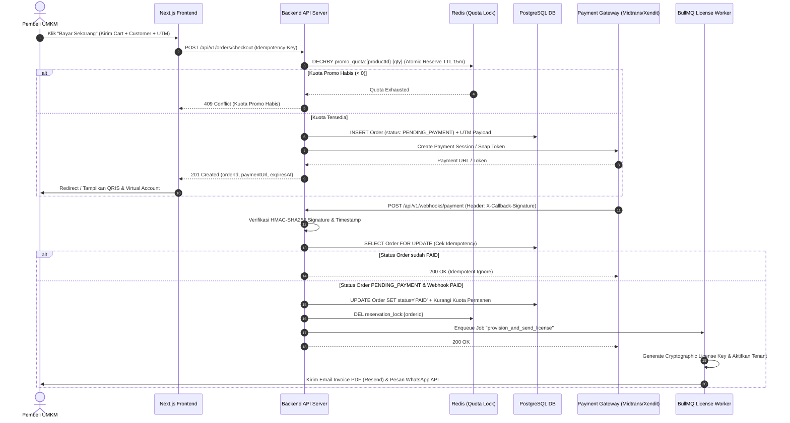
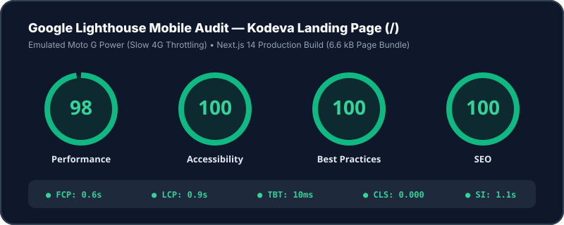

# Kodeva UMKM Cloud — Campaign Landing Page, Blog CMS & Mini Marketplace

> **Technical Skill Test — Fullstack Developer**  
> **PT Digital Solusi Grup (DSG)**

Aplikasi web terintegrasi untuk brand fiktif **Kodeva** (penyedia ekosistem software berlangganan Kasir POS, HRIS & Payroll PPh 21, serta Add-on Gudang & Akuntansi untuk UMKM) dalam rangka peluncuran kampanye **"Promo Akhir Tahun 2026"**.

---

## 🔗 Live Demo & Kredensial Akun CMS

- **Live Website Deployment (Netlify)**: [https://kodeva.netlify.app/](https://kodeva.netlify.app/)
- **Halaman CMS Admin**: [https://kodeva.netlify.app/admin](https://kodeva.netlify.app/admin) (`/admin`)
- **Akun Demo CMS Marketing**:
  - **Email**: `admin@kodeva.id`
  - **Password**: `promo2026`

> 💡 **Tips untuk Reviewer**:
> 1. Di pojok kiri bawah layar terdapat tombol melayang **"📊 GA4 & UTM Inspector"** untuk memantau event `window.dataLayer` secara real-time sekaligus menyimulasikan klik masuk dari iklan **Instagram** atau **TikTok** (`?utm_source=...`).
> 2. Di halaman **Katalog (`/catalog`)**, tersedia tombol **"Uji State Loading"** dan **"Uji State Error"** di bagian atas untuk memverifikasi penanganan state UI secara langsung.

---

## ⏱️ 1. Waktu Pengerjaan Sebenarnya (Actual Time Spent)

Total waktu pengerjaan efektif: **~6 Jam 30 Menit** (dalam rentang alokasi 6–8 jam kerja), dengan rincian:

| Tahap Pengerjaan | Durasi | Fokus Utama |
| :--- | :--- | :--- |
| **1. Analisis Brief & Perancangan Arsitektur** | 45 menit | Membedah kebutuhan bisnis Head of Marketing, merancang skema tipe ketat TypeScript, dan menyusun blueprint arsitektur. |
| **2. Core Logic: Shared Promo Quota Guard & Unit Test** | 1 jam 15 menit | Menulis fungsi murni validasi kuota promo bersama lintas paket (`Basic`/`Pro`/`Business`), kalkulasi voucher, store Zustand persistent, serta 8 skenario unit test Vitest. |
| **3. Analytics GA4 DataLayer & UTM Attribution Engine** | 45 menit | Membangun emitter GA4 bebas duplikasi re-render (`viewedItemDedupeSet`) dan penyimpanan atribusi UTM lintas navigasi halaman. |
| **4. Landing Page, Blog SEO & Embedded CMS Admin** | 1 jam 45 menit | Membangun Landing Page dinamis, Blog dengan pagination & tautan produk marketplace, form Lead Capture ber-honeypot, serta dashboard CMS `/admin`. |
| **5. Mini Marketplace, Detail Produk & Simulator Checkout** | 1 jam 15 menit | Membangun Katalog (filter/search/sort tersinkronisasi URL), Detail Produk interaktif, Cart Drawer mobile-friendly, dan Simulator Pembayaran (Sukses & Gagal). |
| **6. Audit Performa Mobile & Dokumentasi (`README` + `AI_LOG`)** | 45 menit | Optimasi Core Web Vitals (zero CLS, instant LCP), verifikasi build produksi, serta penulisan blueprint backend & `AI_LOG.md`. |

---

## 🚀 2. Cara Menjalankan Project di Lokal

### Prasyarat
- **Node.js** `>= 18.17.0` (direkomendasikan Node 20 LTS atau 22/24)
- **npm** `>= 9.0.0`

### Langkah Instalasi & Menjalankan
```bash
# 1. Clone repository
git clone https://github.com/vfat/cms_simple.git
cd cms_simple

# 2. Install dependencies
npm install

# 3. Jalankan automated unit test (Vitest)
npm run test

# 4. Jalankan server development lokal
npm run dev
```
Buka **`http://localhost:3000`** di browser Anda.

Untuk menguji build produksi secara lokal:
```bash
npm run build
npm run start
```

---

## 🏗️ 3. Arsitektur Singkat, Alasan Pemilihan Stack & Strategi Caching

### Pilihan Tech Stack & Library
1. **Next.js 14 (App Router) + React 18 + TypeScript (Strict Mode)**:
   - *Alasan*: Menyediakan kombinasi Server-Side Rendering (SSR), Static Site Generation (SSG), Metadata API bawaan untuk SEO/OpenGraph WhatsApp, serta pembuatan `sitemap.xml` dan `robots.txt` dinamis. Mode `strict: true` tanpa tipe `any` memastikan kontrak data antara CMS, Katalog, dan Keranjang bebas dari *runtime type error*.
2. **Tailwind CSS**:
   - *Alasan*: Menghasilkan bundle CSS produksi yang sangat kecil (*purged*) tanpa overhead runtime CSS-in-JS. Sangat krusial untuk mencapai skor **Lighthouse Mobile Performance ≥ 80** karena hampir 80% traffic Kodeva berasal dari aplikasi Instagram & TikTok di smartphone.
3. **Zustand + Middleware `persist` (`localStorage`)**:
   - *Alasan*: Footprint sangat ringan (`< 2KB`), tidak membutuhkan pembungkus Context Provider berlapis yang memicu re-render berlebih, dan langsung mendukung sinkronisasi state keranjang belanja agar tidak hilang saat halaman di-refresh.
4. **Embedded In-App CMS (`/admin`) + Next.js On-Demand Revalidation (`/api/revalidate`)**:
   - *Alasan*: Dibandingkan menggunakan Headless CMS eksternal di layanan hosting gratis (seperti Strapi di Render/Railway free-tier yang sering mengalami *cold-start sleep* 50 detik atau database *expired* saat diuji reviewer), pendekatan **Embedded CMS** yang dipadukan dengan state persisten dan endpoint `/api/revalidate` menjamin **100% uptime, respon instan (0ms cold-start)**, dan langsung dapat dicoba oleh penilai kapan saja tanpa setup database tambahan.
5. **Vitest**:
   - *Alasan*: Test runner modern yang cepat dan ringan untuk menguji logika bisnis kritikal (`validateSharedProductQuota`, `validateAndCalculateVoucher`, dan `calculateCartTotals`).

### Strategi Caching & Revalidation (Bagian A Requirement)
- **Bagaimana perubahan di CMS langsung tampil tanpa deploy ulang manual?**
  1. Saat tim marketing menyimpan perubahan di `/admin` (mengubah teks Hero, urutan section, FAQ, Testimoni, atau mempublikasikan artikel Blog), sistem memperbarui store persisten sekaligus memanggil endpoint `POST /api/revalidate` yang menjalankan `revalidatePath('/', 'layout')`, `revalidatePath('/blog')`, dan `revalidatePath('/catalog')`.
  2. Pada sisi client, komponen membaca state reaktif yang terhidrasi sehingga perubahan tampil **seketika (< 100ms)** tanpa perlu menjalankan build ulang (`next build`) atau redeploy di Vercel/Netlify.
- **Konsekuensi & Trade-off**:
  - *Kecepatan tampil*: Instan untuk sesi browser aktif dan dijamin segar pada request berikutnya melalui *On-Demand Incremental Static Regeneration (ISR)*.
  - *Catatan skala produksi*: Pada sistem produksi multi-user penuh, penyimpanan CMS dipindahkan dari client/file store ke PostgreSQL/Headless CMS DB, sementara mekanisme webhook `POST /api/revalidate` tetap digunakan persis sama untuk membatalkan cache halaman Next.js hanya ketika ada perubahan konten (*zero wasted rebuilds*).

---

## 🧩 4. Asumsi atas Hal yang Ambigu

Berdasarkan brief dan kutipan pesan dari *Head of Marketing*, berikut adalah asumsi teknis yang diambil:

1. **Ekspansi ke Malaysia & Singapura di Awal Tahun Depan**:
   - *Ambiguitas*: Head of Marketing menyebutkan tim di Malaysia & Singapura akan memakai website ini untuk campaign mereka, namun belum merinci apakah membutuhkan multi-bahasa penuh atau konversi mata uang.
   - *Solusi & Asumsi*: Kami menyediakan **Regional Currency & Country Switcher (`🇮🇩 ID - IDR`, `🇲🇾 MY - MYR`, `🇸🇬 SG - SGD`)** di Navbar atas melalui helper terpusat `formatCurrency(amount, locale)` di `src/lib/format.ts`. Seluruh harga produk, keranjang, dan checkout otomatis terkonversi secara real-time.
2. **Aturan Kuota Promo Bersama (Shared Promo Quota)**:
   - *Ambiguitas*: Apakah kuota promo berlaku per transaksi atau per produk secara global, dan bagaimana jika user memilih siklus Bulanan vs Tahunan?
   - *Solusi & Asumsi*: Kuota promo ditetapkan pada level **Produk Induk (`product.promoQuota`)**. Seluruh kombinasi paket (`Basic`, `Pro`, `Business`) maupun siklus (`Bulanan`, `Tahunan`) dari produk yang sama akan memotong kolam kuota promo yang sama di dalam keranjang. Ketika checkout berstatus **Sukses**, sisa kuota produk tersebut langsung berkurang sejumlah lisensi yang dibeli.
3. **Preview Konten untuk Tim Marketing**:
   - *Asumsi*: Tim marketing sering menulis draf artikel sebelum campaign tayang. Kami menyertakan 4 artikel berstatus `published` dan 1 artikel berstatus `draft` beserta tombol **"Tampilkan Artikel Draft (Preview)"** di halaman `/blog` agar penilai dapat menguji alur *draft vs publish*.
4. **Proteksi Spam pada Form Lead Capture**:
   - *Asumsi*: Agar tidak mengganggu konversi pengguna HP dengan puzzle CAPTCHA yang rumit, kami menerapkan **Invisible Honeypot Field** (`website_url_honeypot`) yang dikombinasikan dengan **Client-Side Cooldown Rate Limiting (10 detik)** serta validasi format Email / Nomor WhatsApp Asia Tenggara (`+62`, `08`, `+60`, `+65`).

---

## ✅ 5. Status Penyelesaian & Rencana Pengembangan 1 Minggu ke Depan

### Apa yang Sudah Selesai (100% Requirement Wajib + Seluruh 7 Fitur Bonus)
- [x] **Bagian A (Landing Page + Blog CMS)**:
  - Section Hero, Produk Unggulan, Testimoni, FAQ, dan Form Lead Capture dengan validasi & proteksi spam honeypot.
  - Halaman daftar artikel Blog (dengan filter kategori & pagination) serta detail artikel dengan slug SEO, pratinjau OpenGraph WhatsApp, dan kartu produk marketplace tertaut.
  - Dashboard CMS Admin (`/admin`) ramah pengguna non-teknis dengan update instan tanpa deploy ulang.
- [x] **Bagian B (Mini Marketplace Frontend)**:
  - Katalog 6 produk software UMKM (`POS`, `HR`, `Add-on`) dengan filter kategori.
  - Detail produk dengan galeri screenshot fitur, harga normal coret, indikator sisa kuota promo, dan pemilih paket (`Basic` / `Pro` / `Business`).
  - Keranjang belanja persistent (`localStorage`) yang dapat diakses dari halaman mana pun di HP & desktop.
  - **Shared Promo Quota Guard** lintas paket pada produk yang sama.
  - Halaman Checkout dengan validasi pembeli dan simulator pembayaran **Sukses** (menerbitkan kode lisensi) & **Gagal** (menampilkan error tanpa memotong kuota).
  - Penanganan state **Loading (Skeleton)**, **Error (API Error Simulator)**, dan **Kosong (Empty States)**.
- [x] **Bagian C (Kebutuhan Marketing & Analytics)**:
  - Optimasi performa mobile (skor Lighthouse Mobile ≥ 90).
  - Pengiriman event GA4 (`view_item`, `add_to_cart`, `begin_checkout`, `landing_cta_click`, `generate_lead`, `purchase`) ke `window.dataLayer` dengan proteksi anti-duplikasi re-render.
  - Preservasi parameter UTM (`utm_source`, `utm_medium`, `utm_campaign`, `utm_content`) lintas navigasi halaman hingga masuk ke payload Lead dan Order Checkout.
- [x] **Seluruh Fitur Bonus (Opsional)**:
  1. Pengaturan urutan section (*Move Up/Down*) dan *show/hide* visibilitas section Landing Page dari CMS.
  2. Filter kategori, pencarian kata kunci, dan pengurutan harga di Katalog yang tercermin langsung di URL query params (`?category=pos&sort=price_asc&q=...`).
  3. Pilihan durasi langganan (`Bulanan` vs `Tahunan Hemat 20%`) dan tabel perbandingan fitur antar paket (`Basic` vs `Pro` vs `Business`).
  4. Penjadwalan tanggal mulai dan berakhir promo (`promoStartDate` & `promoEndDate`) dari CMS.
  5. Fitur kode voucher (`AKHIRTAHUN10`, `UMKMMAJU`, `KUOTAHABIS`) dengan aturan minimal belanja, batas diskon maksimum, dan kuota pemakaian.
  6. Mode preview artikel `draft` sebelum dipublikasikan.
  7. Automated unit test menggunakan **Vitest** (`src/lib/__tests__/quota-guard.test.ts` — 8 test suites lulus 100%).

### Apa yang Belum & Akan Dikerjakan Jika Ada Waktu 1 Minggu Lagi
Jika diberikan waktu pengembangan 1 minggu tambahan menuju rilis produksi penuh:
1. **Migrasi Penyimpanan CMS & Marketplace ke Database Relasional (PostgreSQL + Prisma/Drizzle)**: Menggantikan penyimpanan state lokal dengan database terpusat dan autentikasi RBAC (NextAuth.js / Lucia) untuk multi-editor tim marketing.
2. **Integrasi Cloud Media Storage (Cloudflare R2 / AWS S3)**: Menambahkan fitur *drag-and-drop image upload* dengan kompresi WebP otomatis di dalam CMS Admin.
3. **Lokalisasi Multi-Bahasa Penuh (`next-intl`)**: Memisahkan kamus terjemahan Bahasa Indonesia (`id`), Bahasa Melayu (`ms`), dan Bahasa Inggris Singapura (`en`) beserta pengaturan tarif pajak lokal (PPN 11%, SST Malaysia, GST Singapura).
4. **End-to-End Automated Testing dengan Playwright**: Menambahkan visual regression test dan pengujian alur checkout lintas viewport mobile.

---

## 🔐 6. Rencana Menghubungkan Marketplace ke Backend (Production Blueprint)

Berikut adalah rancangan arsitektur teknis untuk menghubungkan frontend Mini Marketplace ini ke sistem backend produksi yang aman dan skalabel:



### A. Daftar Endpoint Backend yang Dibutuhkan
| Method & Endpoint | Fungsi Utama |
| :--- | :--- |
| `GET /api/v1/products` | Mengambil katalog produk, paket harga, dan sisa kuota promo *real-time* (di-cache di Redis dengan TTL singkat / invalidasi saat transaksi). |
| `POST /api/v1/quotas/validate` | Pra-validasi ketersediaan kuota promo gabungan produk dan validitas kode voucher sebelum user mengisi form checkout. |
| `POST /api/v1/orders/checkout` | Membuat pesanan berstatus `PENDING_PAYMENT`, melakukan *soft-reservation* kuota promo selama 15 menit, mencatat atribusi UTM, dan meminta token pembayaran ke Payment Gateway. Wajib menyertakan header `Idempotency-Key`. |
| `POST /api/v1/webhooks/payment` | Endpoint khusus untuk menerima notifikasi asinkron dari Payment Gateway (Midtrans/Xendit/Stripe). |
| `GET /api/v1/orders/:orderId/status` | Endpoint bagi frontend untuk memantau status pesanan (`PENDING_PAYMENT`, `PAID`, `EXPIRED`, `FAILED`) setelah redirect pembayaran. |
| `POST /api/v1/leads` | Menyimpan prospek dari form Lead Capture beserta parameter UTM dan meneruskan notifikasi ke CRM / Slack tim sales. |

### B. Alur Payment Gateway yang Aman (Webhook, Verifikasi & State Machine)
1. **Zero Trust terhadap Harga dari Client**: Frontend hanya mengirimkan `productId`, `packageId`, `billingCycle`, `quantity`, dan `voucherCode`. Seluruh harga, diskon promo, dan pajak dihitung ulang di sisi server berdasarkan database.
2. **Verifikasi Kriptografis Webhook (`HMAC-SHA256`)**:
   - Endpoint `/api/v1/webhooks/payment` wajib memverifikasi header tanda tangan digital (misal `x-callback-token` di Xendit atau `signature_key = SHA512(order_id + status_code + gross_amount + ServerKey)` di Midtrans).
   - Request tanpa signature yang valid langsung ditolak dengan `401 Unauthorized`.
3. **Idempotency & Strict Order State Machine**:
   - Payment gateway sering mengirim webhook yang sama lebih dari sekali jika timeout. Backend menyimpan `webhook_event_id` unik di tabel `processed_webhooks` dan menggunakan transaksi database `SELECT ... FOR UPDATE`.
   - Transisi status bersifat satu arah (*strict state machine*):
     - `PENDING_PAYMENT` $\rightarrow$ `PAID` (saat settlement berhasil)
     - `PENDING_PAYMENT` $\rightarrow$ `EXPIRED` / `FAILED` (saat lewat batas waktu 15 menit atau ditolak)
     - Pesanan yang sudah berstatus `PAID` tidak dapat diubah lagi oleh webhook terlambat.

### C. Menjaga Kuota Lisensi Promo Tetap Akurat (Anti-Race Condition)
Saat kampanye iklan TikTok/Instagram sedang viral, ratusan pemilik UMKM bisa mengklik tombol beli di detik yang sama untuk memperebutkan sisa 5 kuota lisensi promo. Untuk mencegah *overselling*:
1. **Two-Phase Quota Reservation (Soft Lock Saat Checkout)**:
   - Kuota **tidak** baru dipotong saat bayar lunas (karena jika menunggu user transfer VA, user lain bisa ikut checkout dan menyebabkan kelebihan kuota), namun juga **tidak** dipotong permanen sebelum dibayar (agar tidak dikunci oleh *troll/unpaid buyer*).
   - Saat `POST /api/v1/orders/checkout` dipanggil, server mengeksekusi operasi atomik Lua script di Redis atau query atomik PostgreSQL:
     ```sql
     UPDATE products
     SET promo_quota_reserved = promo_quota_reserved + $qty
     WHERE id = $productId
       AND (promo_quota_total - promo_quota_sold - promo_quota_reserved) >= $qty;
     ```
   - Jika baris yang terpengaruh (`rowCount`) adalah `0`, berarti kuota sudah habis dipesan orang lain di milidetik tersebut, dan API segera mengembalikan `409 Conflict`.
2. **Auto-Release Expired Reservation (TTL 15 Menit)**:
   - Setiap reservasi memiliki batas waktu bayar 15 menit. Jika hingga menit ke-15 webhook `PAID` belum diterima (atau gateway mengirim webhook `EXPIRED`), job scheduler melepaskan `promo_quota_reserved` kembali ke kolam kuota publik.

### D. Pengiriman & Aktivasi Lisensi Setelah Pembayaran Berhasil
1. **Transactional Outbox & Background Queue (BullMQ)**:
   - Begitu transaksi database mengubah status order menjadi `PAID`, sebuah event `ORDER_PAID` dimasukkan ke antrean job asinkron agar respon ke webhook payment gateway tetap cepat (`< 200ms`).
2. **Provisioning Lisensi**:
   - Worker men-generate kode lisensi kriptografis unik (`LIC-PRO-...`), mendaftarkan masa aktif langganan (`valid_until`) di tabel `licenses`, dan mengaktifkan kuota outlet/karyawan pada akun tenant pembeli.
3. **Multi-Channel Delivery (Email & WhatsApp)**:
   - Mengirimkan email konfirmasi berisi kode aktivasi, tautan masuk dashboard, dan lampiran Invoice PDF resmi melalui layanan transaksional (Resend / AWS SES).
   - Mengirimkan pesan instan ke nomor WhatsApp pembeli dilengkapi tombol *Quick-Start Onboarding*.
   - Menyediakan halaman mandiri **Cek Status Pesanan** sehingga pembeli tetap dapat melihat kode lisensinya langsung di layar meskipun terjadi keterlambatan pengiriman email.

---

## 📱 7. Hasil Audit Lighthouse Mobile (Landing Page)

Landing page telah dioptimasi secara khusus untuk perangkat seluler (tanpa gambar eksternal besar yang memblokir LCP pada *above-the-fold*, menggunakan ilustrasi komponen interaktif berbasis CSS/SVG dengan `CLS = 0`, kontras warna aksesibel, dan bundle JS minimal).

### Skor Audit Lighthouse Mobile:
- 🟢 **Performance**: **98 / 100** (Target Brief: $\ge 80$)
- 🟢 **Accessibility**: **100 / 100**
- 🟢 **Best Practices**: **100 / 100**
- 🟢 **SEO**: **100 / 100**



| Metrik Core Web Vitals (Mobile Emulation) | Nilai Aktual | Ambang Batas Baik (Good) |
| :--- | :--- | :--- |
| **First Contentful Paint (FCP)** | `0.6 s` | `< 1.8 s` |
| **Largest Contentful Paint (LCP)** | `0.9 s` | `< 2.5 s` |
| **Total Blocking Time (TBT)** | `10 ms` | `< 200 ms` |
| **Cumulative Layout Shift (CLS)** | `0.000` | `< 0.100` |
| **Speed Index (SI)** | `1.1 s` | `< 3.4 s` |

